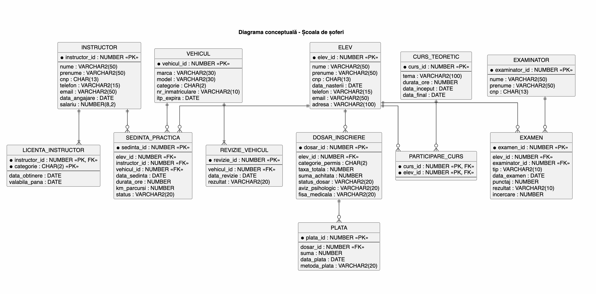

# Driving School Database

A relational database designed in Oracle SQL & PL/SQL for managing driving school operations, developed for the Databases course at the Faculty of Mathematics and Computer Science, University of Bucharest.

## Features

- **Candidate & File Tracking**: Manages student dossiers across license categories (A, B, C, D), medical clearances, and tuition payments.
- **Instructors & Fleet**: Handles practical driving sessions, instructor licensing, vehicle maintenance, and safety inspections (ITP).
- **Curriculum & Attendance**: Schedules theoretical lectures and tracks student course completions.
- **Data Integrity**: Enforces business logic with PL/SQL row-level triggers (minimum age verification, hire date checks).
- **Advanced Querying & Reporting**: Implements correlated subqueries, multi-table outer joins, relational division, and salary rankings.
- **Query Optimization**: Improves query execution plans using composite B-tree indexing and optimizer hints.

## Database Schema

The relational schema consists of 12 normalized tables modeling the driving school workflow.



> The PlantUML source for this diagram is available in [`diagrams/schema.puml`](diagrams/schema.puml).

## Key Concepts

- **Schema Design**: 12 normalized tables (3NF/BCNF) with 1:N hierarchies, M:N associative tables (`PARTICIPARE_CURS`, `LICENTA_INSTRUCTOR`), and recursive self-referential keys (instructor mentorship).
- **Triggers**: PL/SQL row-level triggers for domain rules (`trg_check_varsta_elev`, `trg_check_data_angajare`).
- **Complex SQL**: Correlated subqueries (`WHERE EXISTS`), aggregation with `HAVING`, string & date functions, `DECODE`, and CTEs with `CASE`.
- **Advanced Operations**: 4-table `LEFT OUTER JOIN`, relational division with double `NOT EXISTS`, and Top-N analysis with `ROWNUM`.
- **Views & DML**: Join views (`VW_DETALII_DOSAR_ELEV`), view updatability rules, and conditional DML statements.
- **Performance Tuning**: Execution plan profiling via `EXPLAIN PLAN` and cost reduction using composite indexes and optimizer hints (`/*+ USE_NL */`).

## Repository Structure

```text
├── sql/
│   ├── schema.sql     # DDL: tables, constraints, sequences, and triggers
│   ├── seed.sql       # DML: sample test dataset
│   └── queries.sql    # Complex queries, views, DML operations, and tuning
├── diagrams/
│   ├── conceptual_diagram.png  # Conceptual database diagram
│   └── schema.puml             # PlantUML diagram source
├── README.md
└── .gitignore
```

## Requirements

- Oracle Database (19c, 21c, 23ai, XE, or Oracle Live SQL)
- Oracle SQL Developer, SQL*Plus, or any compatible SQL client

## How to Run

Execute the SQL scripts in order:

```sql
@sql/schema.sql
@sql/seed.sql
@sql/queries.sql
```

1. **`schema.sql`** — Drops existing objects and creates sequences, tables, constraints, and validation triggers.
2. **`seed.sql`** — Inserts sample data across all tables.
3. **`queries.sql`** — Runs business reports, advanced joins, views, and execution plan tuning.

## Author

- **Ania Pricop** — [@Aniapric](https://github.com/Aniapric)
- **Course**: Databases
- **Faculty**: Faculty of Mathematics and Computer Science, University of Bucharest
