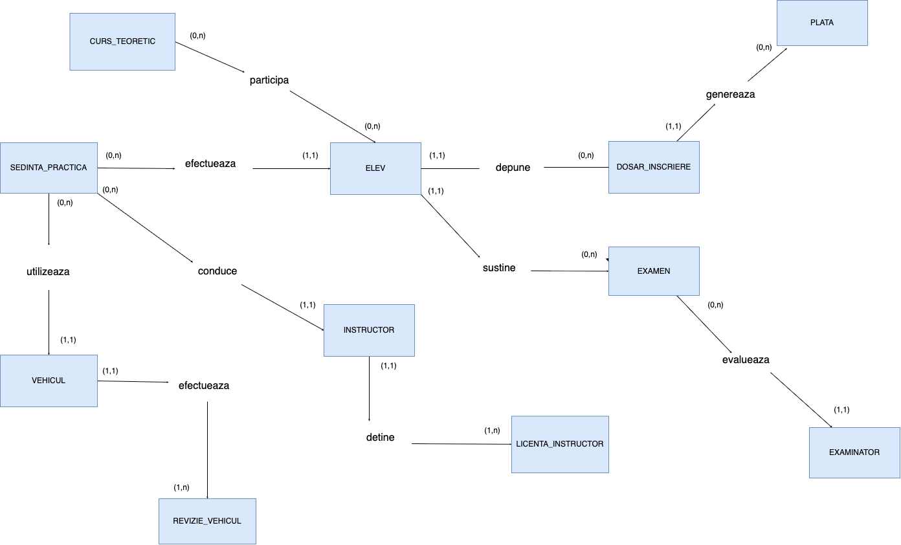

# Driving School Database

A relational database designed in Oracle SQL & PL/SQL for managing driving school operations, developed for a Databases university course.

## Features

- **Student & Dossier Management**: Tracks candidate enrollments across licensing categories (A, B, C, D), medical/psychological clearances, and tuition payment ledgers.
- **Scheduling & Fleet Dispatching**: Manages practical driving sessions, instructor allocations, and vehicle technical safety inspections (ITP).
- **Theoretical Modules**: Schedules classroom sessions and monitors student attendance across curriculum topics.
- **Automated Validation Triggers**: PL/SQL row-level triggers enforce business rules directly at the data tier (minimum age of 18, valid employment dates).
- **Advanced Querying**: Implements correlated subqueries, inline views, aggregation filters, outer joins, and relational division (students who completed all courses).
- **Performance Optimization**: Tuned query execution plans with composite B-tree indexing and Oracle hints, eliminating full table scans and reducing query cost.

## Database & SQL Concepts Used

- **Relational Schema Design & Normalization**:
  - 12 normalized tables adhering to 3NF and BCNF.
  - Multi-table cardinality handling: 1:N hierarchies, M:N associative bridge tables (`PARTICIPARE_CURS`, `LICENTA_INSTRUCTOR`), and recursive self-referential foreign keys (mentor relationships).
- **Data Integrity & PL/SQL Triggers**:
  - `trg_check_varsta_elev`: Ensures students are at least 18 years old upon registration.
  - `trg_check_data_angajare`: Prevents invalid future hiring dates for instructors.
- **Advanced SQL Reporting**:
  - Correlated subqueries using `WHERE EXISTS`.
  - Derived inline views in the `FROM` clause with `LEFT OUTER JOIN` and `NVL`.
  - Multi-level grouping with `HAVING` and scalar subqueries.
  - Conditional mappings using `DECODE`, `CASE`, and Common Table Expressions (`WITH`).
  - **Relational Division**: Simulating universal quantification ($R \div S$) via double-negated existential queries (`NOT EXISTS ... NOT EXISTS`).
  - Multi-table `LEFT OUTER JOIN` across 4 relational tables preserving unassigned records.
  - Top-N analysis for salary rankings.
- **Views & Updatability Rules**:
  - Complex join view `VW_DETALII_DOSAR_ELEV` computing outstanding balances.
  - Demonstrates Oracle key-preserved table update permissions and virtual column modification restrictions (`ORA-01733`).
- **Performance Tuning (CBO & Indexing)**:
  - Execution plan profiling using `EXPLAIN PLAN` and `DBMS_XPLAN.DISPLAY`.
  - Strategic composite B-tree indexing (`idx_examen_filtru`) and foreign key indexing (`idx_sp_instructor`).
  - Cost reduction from 9 to 4 (~55% drop) by replacing full table scans with index range scans.

## Database Schema

| Table | Description |
| :--- | :--- |
| `ELEV` | Student records with CNP and birth date validation |
| `INSTRUCTOR` | Instructor details, salary, and mentor relationships |
| `VEHICUL` | Fleet vehicles and technical inspection tracking |
| `CURS_TEORETIC` | Theoretical curriculum modules |
| `EXAMINATOR` | Police examiners administering tests |
| `DOSAR_INSCRIERE` | Enrollment applications, fees, and clearance status |
| `PLATA` | Tuition payment installments |
| `SEDINTA_PRACTICA` | Practical driving lessons |
| `PARTICIPARE_CURS` | Student attendance for theoretical courses (M:N) |
| `EXAMEN` | Theory and road exam results |
| `LICENTA_INSTRUCTOR` | Instructor licensing categories (M:N) |
| `REVIZIE_VEHICUL` | Periodic vehicle safety inspection history |

A visual diagram of the schema is available in [`diagrams/erd.png`](diagrams/erd.png):



## Repository Structure

```text
├── sql/
│   ├── schema.sql     # Table definitions, constraints, sequences, and triggers
│   ├── seed.sql       # Sample test data insertion
│   └── queries.sql    # Complex queries, views, DML operations, and tuning
├── diagrams/
│   └── erd.png        # Entity-Relationship Diagram
├── README.md
└── .gitignore
```

## How to Run

### Prerequisites
An Oracle Database instance (11g, 12c, 19c, 21c, 23ai, or Oracle LiveSQL) and a client such as Oracle SQL Developer or SQL*Plus.

### Execution
Execute the scripts in the following order:

```sql
@sql/schema.sql
@sql/seed.sql
@sql/queries.sql
```

1. **`schema.sql`**: Drops any pre-existing objects, creates sequences, tables, constraints, and PL/SQL validation triggers.
2. **`seed.sql`**: Populates the database with realistic sample records.
3. **`queries.sql`**: Runs business reports, advanced joins, views, DML demonstrations, and query performance optimizations.

## Author

- **Author**: Ania Pricop ([@Aniapric](https://github.com/Aniapric))
- **Course**: Databases
- **Faculty**: Faculty of Mathematics and Computer Science, University of Bucharest
